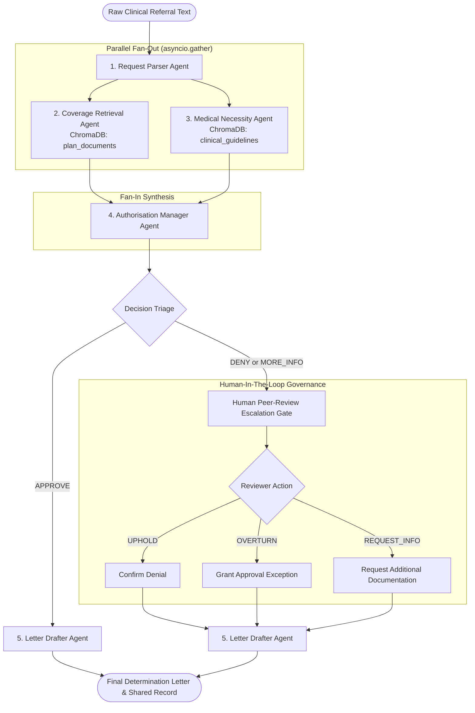

# AuthDesk: Treatment Pre-Authorisation Decision Desk (Multi-Agent System)

An enterprise-grade multi-agent pre-authorisation decision desk built with **Microsoft Semantic Kernel (Python)**, **ChromaDB RAG**, **FastAPI**, and an interactive **Streamlit** user interface.

The system automates the clinical utilization review process for health insurance pre-authorisations through grounded retrieval, parallel fan-out/fan-in agent orchestration, an immutable shared case record, and a mandatory clinical peer-review escalation gate for adverse determinations.

---

## 🏗️ Architecture & Orchestration Flow



---

## 📂 Project Structure

```text
├── agents/                       # Specialized Agent Modules
│   ├── __init__.py
│   ├── request_parser.py         # Parses clinical referral into structured entities
│   ├── coverage_retrieval.py     # Grounded RAG over plan documents (Gold-500)
│   ├── medical_necessity.py      # Grounded RAG over clinical guidelines
│   ├── authorisation_manager.py  # Merges findings -> decides APPROVE/DENY/MORE_INFO
│   └── letter_drafter.py         # Drafts formal determination letter citing clauses
├── case_record.py                # Shared Case Record: {field, value, written_by, timestamp}
├── orchestrator.py               # Parallel fan-out/fan-in coordination & step executor
├── rag.py                        # ChromaDB dual-collection vector engine (100% offline)
├── llm_client.py                 # Semantic Kernel connector + deterministic rule fallback
├── app.py                        # Streamlit step-by-step interactive application
├── evaluate.py                   # 10-case evaluation benchmark runner
├── data/
│   ├── plan_documents/
│   │   └── gold_500_plan.md      # Gold-500 Comprehensive Plan (15 clauses)
│   ├── guidelines/
│   │   └── clinical_guidelines.md# Clinical Guidelines (10 guideline clauses)
│   └── test_requests.json        # 10 benchmark test referrals
├── requirements.txt              # Project dependencies
└── README.md                     # Documentation & usage guide
```

---

## 🚀 Setup & Execution Guide

### 1. Installation
Install the dependencies in your Python 3.11+ environment:
```powershell
pip install -r requirements.txt
```

### 2. Configure LLM (Optional)
AuthDesk features an integrated offline rule-based fallback so the prototype **runs 100% offline without any API keys or network connection**.

To optionally enable Google Gemini through Microsoft Semantic Kernel:
Create a `.env` file in the workspace root:
```env
GEMINI_API_KEY=your_gemini_api_key_here
LLM_MODEL=gemini-3.5-flash-lite
```

### 3. Launch Streamlit Interactive UI
Run the step-by-step Streamlit app:
```powershell
streamlit run app.py
```
Open **http://localhost:8501** in your browser:
- **Select any pre-authorisation referral** (`REQ-01` to `REQ-10`) or type custom clinical text.
- Use the **"Next Step ⏭️"** button to execute agent-by-agent, or enable **"Auto-play"**.
- Watch the live stepper highlight active agents and view the live provenance audit log `{field, value, written_by, timestamp}` as each agent writes to the shared record.
- When an adverse decision occurs (`DENY` / `MORE_INFO`), test the **Peer Review Escalation** buttons: **Uphold**, **Overturn**, or **Request Info**.

### 4. Run Benchmark Evaluation Suite
Execute the standardized 10-request benchmark:
```powershell
python evaluate.py
```

---

## 📊 Evaluation Benchmark Results (10 Requests)

```text
================================================================================
AUTHDESK: TREATMENT PRE-AUTHORISATION MULTI-AGENT EVALUATION BENCHMARK
Total Test Requests: 10
================================================================================

ID       | EXPECTED   | ACTUAL     | DEC   | EXPECTED CLAUSES               | ACTUAL CLAUSES                     | RECALL
---------------------------------------------------------------------------------------------------------------------
REQ-01   | APPROVE    | APPROVE    | PASS  | PLAN-2.1, PLAN-7.1, GL-MRI-3.1 | PLAN-2.1, PLAN-7.1, GL-MRI-3.1     | 100%  
REQ-02   | APPROVE    | APPROVE    | PASS  | PLAN-2.2, GL-TKR-4.1           | PLAN-2.2, PLAN-7.1, GL-TKR-4.1     | 100%  
REQ-03   | APPROVE    | APPROVE    | PASS  | PLAN-3.1, GL-ONC-6.1           | PLAN-3.1, PLAN-7.1, GL-ONC-6.1     | 100%  
REQ-04   | APPROVE    | APPROVE    | PASS  | PLAN-2.4, GL-BAR-5.1           | PLAN-2.4, PLAN-7.1, GL-BAR-5.1     | 100%  
REQ-05   | DENY       | DENY       | PASS  | PLAN-4.1                       | PLAN-4.1, GL-MRI-3.1               | 100%  
REQ-06   | DENY       | DENY       | PASS  | PLAN-4.2                       | PLAN-4.2                           | 100%  
REQ-07   | DENY       | DENY       | PASS  | PLAN-2.1, GL-MRI-3.2           | PLAN-2.1, PLAN-7.1, GL-MRI-3.2     | 100%  
REQ-08   | DENY       | DENY       | PASS  | PLAN-2.2, GL-KNEE-2.1          | PLAN-2.2, PLAN-7.1, GL-KNEE-2.1    | 100%  
REQ-09   | MORE_INFO  | MORE_INFO  | PASS  | PLAN-7.2, GL-KNEE-2.1          | PLAN-7.2, GL-KNEE-2.1              | 100%  
REQ-10   | MORE_INFO  | MORE_INFO  | PASS  | PLAN-7.2, GL-CT-8.1            | PLAN-7.2, GL-CT-8.1                | 100%  

==================================================
EXECUTIVE SUMMARY METRICS
==================================================
Decision Accuracy      : 100.0% (10/10)
Clause Correctness     : 100.0% (10/10)
Average Clause Recall  : 100.0%
Average Clause Prec.   : 78.3%

CONFUSION MATRIX:
                      ACTUAL PREDICTION
                  APPROVE   DENY   MORE_INFO
EXPECTED APPROVE   |   4       0        0    
EXPECTED DENY      |   0       4        0    
EXPECTED MORE_INFO |   0       0        2    
==================================================
```

---

## 🔒 Shared Case Record & Peer Review Governance

1. **Shared Case Record (`case_record.py`)**:
   Every agent reads from and appends to a single unified case object. Every state modification records a change history entry:
   ```json
   {
     "field": "decision",
     "value": "DENY",
     "written_by": "Authorisation Manager",
     "timestamp": "2026-11-17T23:18:12"
   }
   ```
2. **Peer Review Escalation**:
   Adverse decisions (`DENY` and `MORE_INFO`) cannot issue automated determination letters. The system pauses in `PENDING_HUMAN_REVIEW` status. When a licensed clinical peer reviewer selects `UPHOLD` or `OVERTURN`:
   - The initial `ai_decision` is preserved intact for medicolegal auditability.
   - The final determination is updated to reflect the clinician's verdict.
   - The Letter Drafter Agent synthesizes the post-review determination letter citing the clinician's notes and appeal rights under `PLAN-7.3`.
